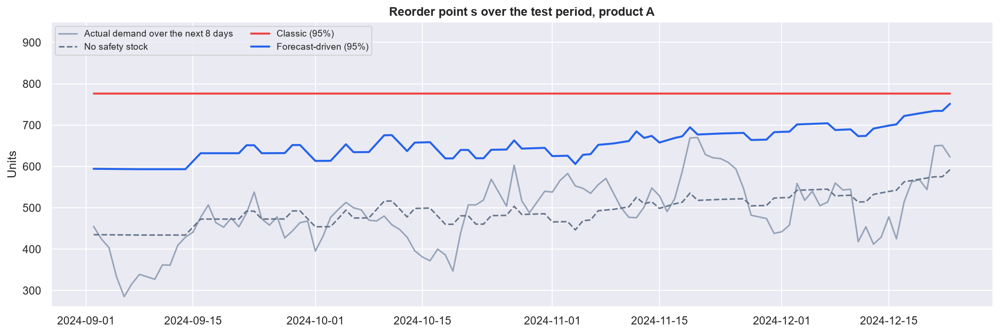

# Demand Forecasting and Inventory Optimization

From daily demand to replenishment decisions on a **synthetic** retail dataset (5 products, 730 days): explore the data, compare a few forecasting models, turn the best forecast into reorder points, and test the policies by simulation.

The project is deliberately simple: standard models (moving average, SARIMAX, LightGBM), a classic (s, S) inventory policy, and a simulator of about 80 lines.

## Main results

| Question | Answer |
|---|---|
| How good are the forecasts? | Weighted absolute percentage error (WAPE) is about 0.36-0.37 for every reasonable model. LightGBM (cross-validated MAE 28.9) is slightly better than SARIMAX (29.2) and a simple month $\times$ promotion average (29.4), but the differences are small. A 28-day moving average, which ignores season and promotion, is clearly worse (31.4). On the last 120 days, LightGBM and the simple average are equal (WAPE 0.36). |
| Why is the error so large? | Demand is mostly noise: month and promotion explain only about 27% of the variance, and there is almost no autocorrelation left. No model can remove this noise, so **safety stock is needed**. |
| How is the safety stock sized? | Safety stock = z $\times$ (standard deviation of the **forecast error**) $\times$ sqrt(lead time + review period). For a 95% target this is about 150-170 units per product. |
| Does a forecast-driven reorder point beat the classic one? | On the last 120 days (a low-demand season), at a 95% target, it keeps **about 18% less stock** (2,216 vs 2,714 units) with no lost sales, and is **13.8% cheaper**. When each policy uses its own cheapest service target, the gap is smaller: about **6%**. |
| Does it hold in other conditions? | In the higher-demand window (March-September 2024), the flat classic reorder point is too low: it loses sales (fill rate 98.05%) and costs about 2.6 times more than the forecast-driven policy, which keeps more stock there (fill rate 99.99%). The forecast moves stock to where demand is. In a sensitivity analysis (3 lead times x 3 service targets) the forecast-driven policy is cheaper in 8 of 9 scenarios (by 7-19%) and more expensive in one (lead time 14 days, 90% target: 3.4% more). Over 200 simulated demand paths it is cheaper in about 99% of them. |
| Is a safety stock really needed? | Yes. Ordering for the forecast only loses 2.4% of the demand and is the most expensive policy once lost margin is counted (2.3-2.6 times the cost of the others). |

> **Notice**: the data is synthetic and the costs, lead time and order cost are **assumptions** (see [Limitations](#limitations)). The results show how the policies compare with each other, not real savings.

## Key figures





*Right panel: at the same service target the two policies hold different stock, so compare each policy at its cheapest target (forecast-driven is about 6% cheaper), not point by point.*


## Repo Structure

```
.
├── README.md
├── requirements.txt
├── data/
│   └── inventory_demand_forecasting.csv
│
├── notebooks/
│   ├── eda.ipynb
│   ├── forecasting.ipynb
│   └── inventory_optimization.ipynb
│
├── src/
│   ├── utils.py
│   └── inventory.py
|
└── outputs/
    ├── forecast_results.xlsx
    ├── inventory_results.xlsx
    └── figures/ 
```

## How to run

### Install dependencies

```
pip install -r requirements.txt
```

Run *`forecasting`* before *`inventory_optimization`*. The notebooks find the project root themselves, so they can be started from `notebooks/` or from the root. Random seeds are fixed, and running everything twice gives identical output files.

## Method notes

- **Validation**: the last 120 days are kept as a test set and used once. All earlier days are used for a `TimeSeriesSplit` cross-validation (3 folds, each forecasting the next 60 days) to compare models and to measure the forecast error. All products share the same cut-off dates.
- **Models**: two baselines (28-day moving average, month x promotion average) and two models chosen from the EDA findings: SARIMAX (one per product; promotion, yearly Fourier terms and trend as inputs) and LightGBM (one pooled model; promotion, day of year, product, trend). Prophet and other models were not tried on purpose, because the EDA shows that there is little left to gain.
- **Inventory simulator**: daily-review (s, S) policy, S = s + Q with Q from the EOQ, lost sales, fixed lead time (7 days). Costs come from unit price (assumed unit cost, holding rate, order cost).
- **Three policies**: no safety stock; classic (historical average demand and standard deviation); forecast-driven (forecast plus safety stock from the forecast error).
- **Checks**: the simulator passes a mass-balance check (initial stock + received = sold + final stock); the results are repeated on a second season, with different lead times and service targets, and on 200 simulated demand paths.

## Limitations

- **Synthetic data**: price and stock are independent random draws, `category` is a label for the product, and promotions are independent across products. Findings such as *no weekly cycle, no autocorrelation, noise growing with demand, price irrelevant* describe this dataset and should be re-tested on real data (weekly patterns, intermittent demand, sales lost to stock-outs, price response, variable lead times).
- **Costs, lead time and review period are assumptions.** Lost sales are assumed to be very expensive compared with holding stock, which pushes the best service target up (0.8-0.9).
- The main test covers **120 days of a low-demand season**. The second window (March-September) is out-of-fold, but its forecast error is measured on the same days, so it is slightly optimistic for the forecast-driven policy.
- Two years of data only; model selection and error measurement use the same folds. The trend is estimated from two years and is not extrapolated in a backtest.
- The forecast is made once for the whole horizon and not updated every day.
- Safety stock uses sqrt(lead time + review period), which assumes independent daily errors (supported by the EDA).
- The 200 simulated paths are built around the same forecast, so they favour the forecast-driven policy a little: they show that the result is not luck, not that the noise model is right.
- Products are managed independently, with no capacity or budget limit.

## Data & License

- Data: [Kaggle - Inventory Demand Forecasting](https://www.kaggle.com/datasets/amnariaz22/inventory-demand-forecasting)
- License: MIT
