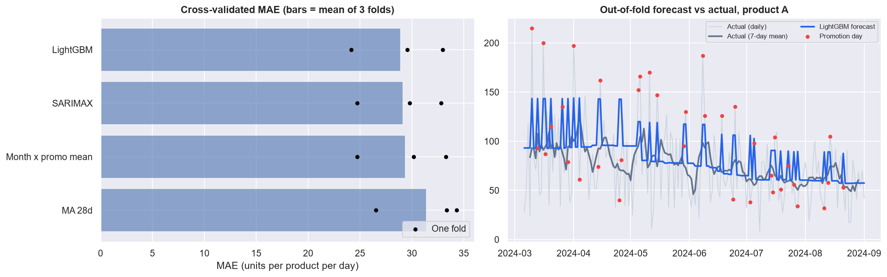
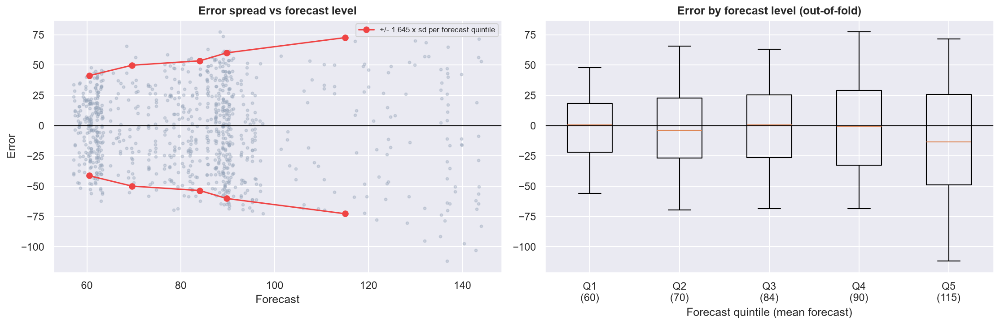
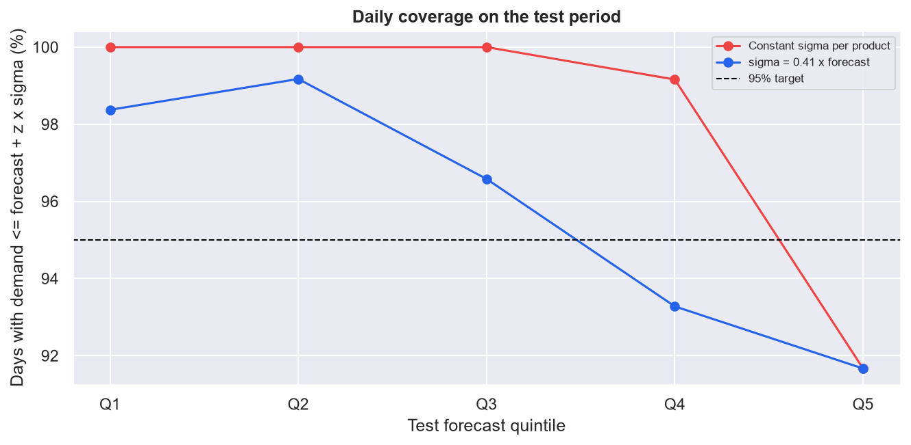
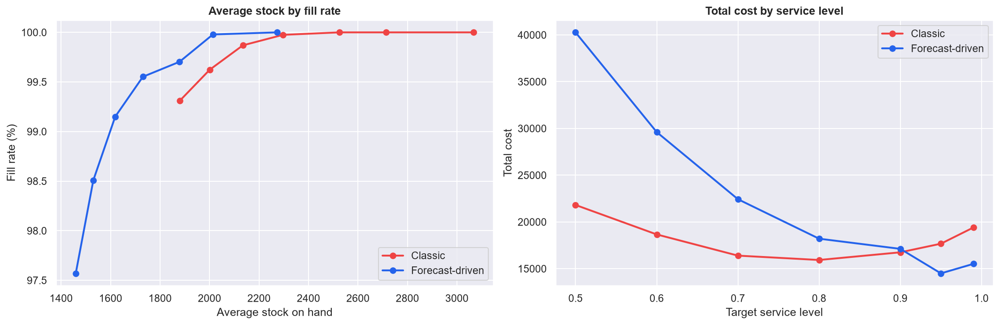
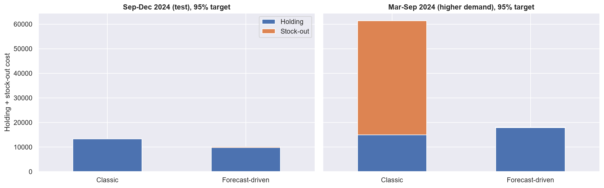

# Demand Forecasting and Inventory Optimization

From daily demand to replenishment decisions on a **synthetic** retail dataset: explore the data, conduct forecasting models, turn the best forecast into reorder points, and test the policies by simulation.

## Main results

| Question | Answer |
|---|---|
| How good are the forecasts? | Weighted absolute percentage error (WAPE) is about 0.36-0.37 for every reasonable model. LightGBM (cross-validated MAE 28.9) is slightly better than SARIMAX (29.1) and a simple month $\times$ promotion average (29.4), but the differences are small. A 28-day moving average, which ignores season and promotion, is clearly worse (31.4). |
| How was SARIMAX tuned? | The order and the number of yearly Fourier pairs are chosen first, with AIC, BIC and cross-validated MAE over 5 ARMA orders x 5 numbers of pairs. **No ARMA terms and one Fourier pair** win on both AIC and BIC. |
| Is there anything left to gain in the forecast? | No. A LightGBM that has seen the days on both sides of every day it predicts is no more accurate than the time-split model on the same days. The error that remains is noise. |
| Why is the error so large? | Demand is mostly noise: month and promotion explain only about 27% of the variance, and there is almost no autocorrelation left. No model can remove this noise, so **safety stock is needed**. |
| What does the forecast error look like? | Close to normal and not autocorrelated, but its **size grows with the demand level**: the standard deviation is about 25 when the forecast is low and 44 when it is high, and **error / forecast is about 0.41** for every product. |
| How is the safety stock sized? | It **follows the forecast**: sigma on day *t* = 0.41 $\times$ forecast on day *t*, so the safety stock = z $\times$ 0.41 $\times$ sqrt(sum of the squared forecasts over the protection interval).. |
| Does a forecast-driven reorder point beat the classic one? | On the last 120 days (a low-demand season), at a 95% target, it keeps **about 26% less stock** (2,014 vs 2,714 units) and is **18.0% cheaper**, at the price of one stock-out day (fill rate 99.98%; classic: 100%). When each policy uses its own cheapest target service level, the gap is smaller: about **9%**. |
| Does it hold in other conditions? | In the higher-demand window (March-September 2024), the flat classic reorder point is too low: it loses sales (fill rate 98.05%) and costs about 2.6 times more than the forecast-driven policy, which keeps more stock there (fill rate 99.99%). The forecast moves stock to where demand is. In a sensitivity analysis (3 lead times x 3 service targets) the forecast-driven policy is cheaper in 8 of 9 scenarios (by 11-26%). Over 200 simulated demand paths it is cheaper in about 96% of them. |
| Is a safety stock really needed? | Yes. Ordering for the forecast only loses 2.4% of the demand and is the most expensive policy once lost margin is counted (2.3-2.8 times the cost of the others). |

> **Notice**: the data is synthetic and the costs, lead time and order cost are **assumptions** (see [Limitations](#limitations)). The results show how the policies compare with each other, not real savings.

## Key figures







*The error grows with the forecast (first figure), so one sigma per product is too wide when demand is low and too narrow when it is high (second figure). The Q-Q plots and the autocorrelation are in `outputs/figures/02_residual_normality.png` and `02_residual_autocorrelation.png`.*




*Right panel: at the same service target the two policies hold different stock, so compare each policy at its cheapest target (forecast-driven is about 9% cheaper), not point by point.*



## Repo Structure

```
.
├── README.md
├── requirements.txt
├── data/
│   └── inventory_demand_forecasting.csv
│
├── notebooks/
│   ├── eda.ipynb
│   ├── forecasting.ipynb
│   └── inventory_optimization.ipynb
│
├── src/
│   ├── utils.py
│   └── inventory.py
|
└── outputs/
    ├── forecast_results.xlsx
    ├── inventory_results.xlsx
    └── figures/ 
```

## How to run

### Install dependencies

```
pip install -r requirements.txt
```

Run *`forecasting`* before *`inventory_optimization`*.

## Method notes

- **Validation**: the last 120 days are kept as a test set and used once. All earlier days are used for a `TimeSeriesSplit` cross-validation (3 folds, each forecasting the next 60 days) to compare models and to measure the forecast error. All products share the same cut-off dates.
- **Models**: two baselines (28-day moving average, month x promotion average) and two models chosen from the EDA findings: SARIMAX (one per product; promotion, one yearly Fourier pair and trend as inputs, no ARMA terms; the order was chosen with AIC, BIC and cross-validation) and LightGBM (one pooled model; promotion, day of year, product, trend).
- **Inventory simulator**: daily-review (s, S) policy, S = s + Q with Q from the EOQ, lost sales, fixed lead time (7 days). Costs come from unit price (assumed unit cost, holding rate, order cost).
- **Three policies**: no safety stock; classic (historical average demand and standard deviation); forecast-driven (forecast plus a safety stock whose spread is proportional to the forecast: sigma = 0.41 x forecast on each day, from the forecast error).
- **Checks on the forecast**: a random 5-fold "noise floor", and residual diagnostics of the selected model (Q-Q plots, error spread by demand level, autocorrelation, coverage of the safety stock).
- **Checks**: the simulator passes a mass-balance check (initial stock + received = sold + final stock); the results are repeated on a second season, with different lead times and service targets, and on 200 simulated demand paths.

## Limitations

- **Synthetic data**: price and stock are independent random draws, `category` is a label for the product, and promotions are independent across products. Findings such as *no weekly cycle, no autocorrelation, error proportional to the demand level, light-tailed errors, price irrelevant* describe this dataset and should be re-tested on real data (weekly patterns, intermittent demand, sales lost to stock-outs, price response, variable lead times).
- **Costs, lead time and review period are assumptions.** Lost sales are assumed to be very expensive compared with holding stock, which pushes the best service target up (0.8-0.95).
- The main test covers **120 days of a low-demand season**. The second window (March-September) is out-of-fold, but its forecast error is measured on the same days, so it is slightly optimistic for the forecast-driven policy.
- Two years of data only; model selection and error measurement use the same folds. The trend is estimated from two years and is not extrapolated in a backtest.
- The forecast is made once for the whole horizon and not updated every day. The promotion calendar of the forecast window is assumed to be known exactly.
- The safety stock assumes independent daily errors, so that their variances add up over the protection interval. The error proportional to the demand level is a property of this synthetic data; real demand may need another noise model.
- The 200 simulated paths are built around the same forecast and their noise is proportional to the forecast by construction, so they favour the forecast-driven policy a little.
- Products are managed independently, with no capacity or budget limit.

## Data & License

- Data: [Kaggle - Inventory Demand Forecasting](https://www.kaggle.com/datasets/amnariaz22/inventory-demand-forecasting)
- License: MIT
